# 초보 투자자를 위한 거시경제 지표와 KOSPI 관계 분석

## 주제와 질문
주식 투자를 시작하는 사람이 여러 경제지표의 흐름을 함께 보며, 무엇이 비슷하게 움직이고 무엇이 다르게 움직이는지 이해하기 위한 교육용 분석이다. 금리·물가·실업률은 경제 상황을 설명하는 지표로, KOSPI·금 가격·원/달러 환율은 주식·금·달러의 움직임을 비교하는 지표로 살펴본다.

이 보고서에서 알아보고 싶은 질문은 다음과 같다.

1. **주가가 오르거나 내릴 때, 금·환율·금리·물가·실업률은 어떻게 움직였을까?**
2. **이 지표들 중 함께 움직이는 것과 반대로 움직이는 것은 무엇일까?**
3. **주식이 떨어질 때, 금이나 달러는 손실을 줄이는 데 도움이 되었을까?**
4. **금이나 달러도 크게 떨어진 적이 있을까? 얼마나 흔들렸을까?**
5. **평소에 보이던 관계가 코로나19나 전쟁 같은 위기에도 유지됐을까?**

주식과 상관관계(두 값이 함께 움직이는 정도)가 낮다는 이유만으로 안전자산이라고 부르지 않는다. 주식이 하락한 시기에 어떻게 움직였는지와 그 자산 자체의 가격이 얼마나 흔들리고 떨어졌는지를 함께 살펴본다. 한국 투자자의 관점에서 금을 비교할 때는 달러 표시 가격과 원화로 바꿔 계산한 가격을 구분한다.

심화·보너스 분석에서는 금리 변화와 1~3개월 뒤 가격 변화의 관계, 환율의 추세(장기간 이어지는 큰 흐름)와 계절성(비슷한 시기에 반복되는 움직임), 과거 자료를 이용한 간단한 환율 예측의 한계를 추가로 살펴본다.

## 데이터와 정제
2016-01~2025-12의 월별 자료 120개월, 6지표 720행을 사용했다. 자료는 한국은행 ECOS와 세계은행 Pink Sheet에서 가져왔다. 2016년 1월의 변화율을 계산하려고 2015년 12월 값도 함께 준비했다. CPI는 전년 동월 대비(지난해 같은 달과 비교한 변화)로 계산했다. 중복, 누락, 비유한값(숫자로 계산할 수 없는 값)이 있으면 오류로 처리했다. 임의 보간(빈 값을 추정값으로 채우는 일)은 하지 않았다. 실제 통합 결과 누락은 0개였다. 극단값(다른 값보다 매우 크거나 작은 값)도 실제 자료이므로 삭제하지 않았다. [출처와 항목 코드](README.md#데이터-출처).

기준금리와 KOSPI는 각 달의 마지막 값을 사용했고, 환율과 금은 한 달 평균값을 사용했다. 실업률은 계절조정(계절마다 반복되는 영향을 덜어낸 값) 자료다. 물가는 전년 동월 대비다. 금리·물가·실업률의 변화에는 %p(퍼센트포인트, 두 비율의 차이)를 사용하고 가격 변화에는 %를 사용했다. 금 가격을 계산하는 기준은 2025-06에 바뀌었다. 한 달 평균 가격의 변화율은 실제로 특정 날짜에 사고팔아 얻는 수익률과 다르다.

## 지표 읽는 법
기준금리는 한국은행이 정하는 정책금리다. 원/달러 환율 상승은 1달러를 사는 데 더 많은 원화가 필요하다는 뜻이다. KOSPI는 국내 주식시장의 전체적인 움직임을 나타내는 지수다. 배당까지 더한 총수익(가격 변화와 받은 배당을 합친 결과)은 아니다. 달러 표시 금 가격은 원화로 금에 투자했을 때의 결과와 다르다. 물가 상승률이 낮아졌다고 물건 가격 자체가 내려갔다는 뜻은 아니다. 실업률은 노동시장 전체 모습 중 일부만 보여준다.

## 분석 결과와 시각화
원래 값과 함께 6개월 이동평균(최근 6개월 값을 계속 새로 평균 낸 값), 가격지수화(시작 가격을 100으로 맞추는 방법), 변화율을 사용했다. Pearson 상관계수(두 값이 같은 방향 또는 반대 방향으로 움직인 정도)와 시차 분석(이번 변화와 몇 개월 뒤 변화의 관계), 국면별 분포(상황별로 값이 어떻게 퍼져 있는지)도 살펴봤다. 표본(분석에 사용한 자료)은 120개월이다. k개월 뒤를 비교하면 사용할 수 있는 자료는 120-k개가 된다. 금리 인상·동결·인하는 전월보다 올랐는지, 같았는지, 내렸는지로 구분했다.

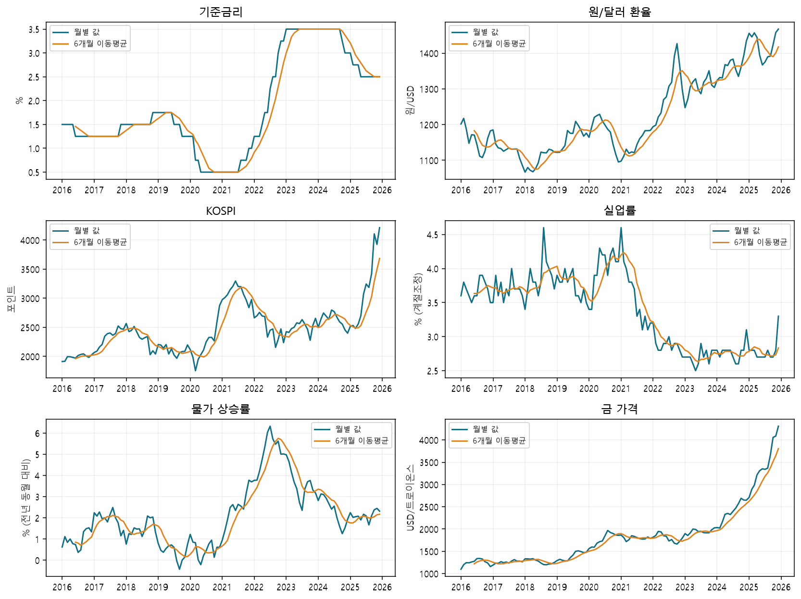
서로 다른 단위는 각자 표시된 세로축에서 읽는다. 이동평균은 최근 6개월 값의 평균이다.

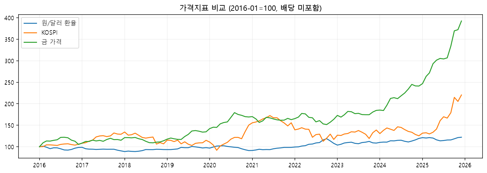
2016-01을 100으로 맞췄다. 초기 기준점과 달러 표시 여부에 따라 비교 의미가 달라진다.

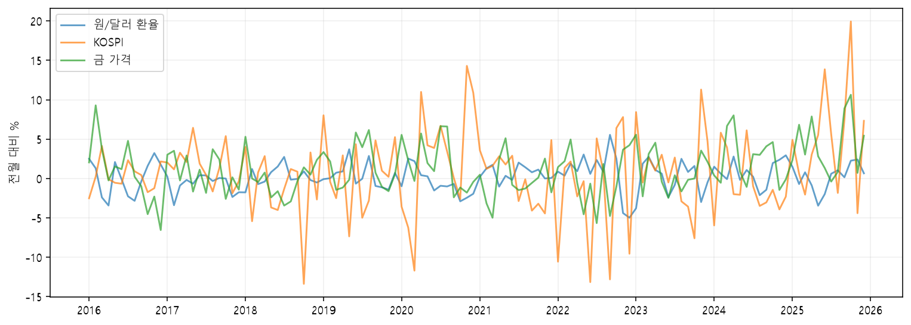
원본 가격 수준과 월간 움직임은 서로 다른 질문에 답한다.

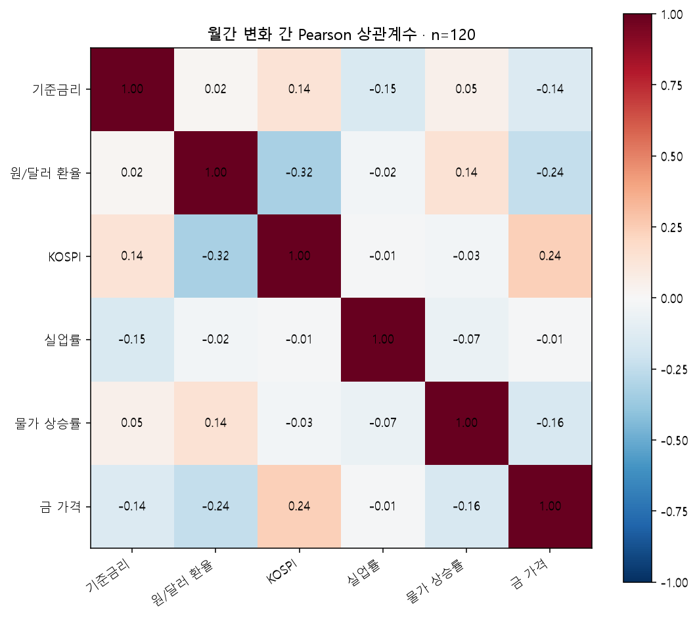
상관계수가 0에 가까우면 선형 관계(한쪽이 움직일 때 다른 쪽도 일정한 방향으로 움직이는 관계)가 약하다는 뜻이다. 두 지표 사이에 아무 관계도 없다는 뜻은 아니다.

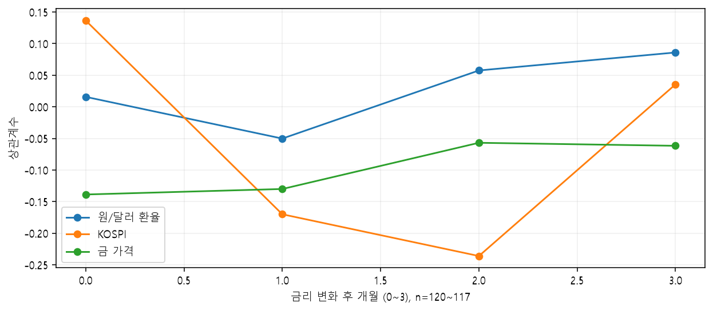
이번 달 금리 변화와 k개월 뒤 다른 지표 변화의 관계다. 여러 시차(몇 개월 뒤인지)를 모두 비교했기 때문에 그중 가장 큰 값이 우연히 나왔을 수도 있다. 따라서 금리 변화가 그 결과를 직접 만들었다거나 미래를 잘 예측한다고 단정하지 않는다.

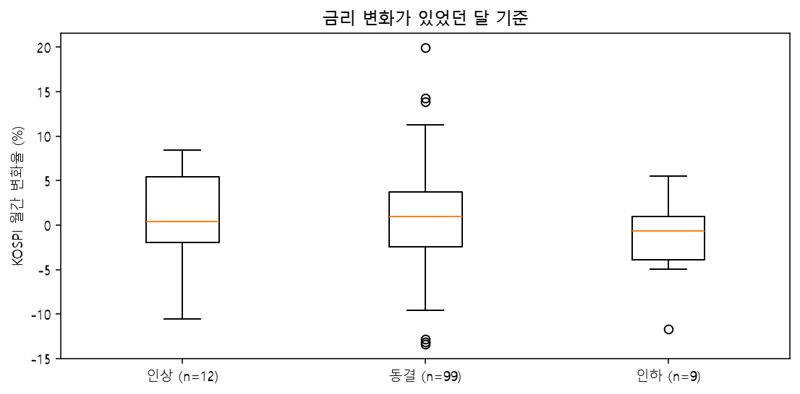
금리가 같은 방향으로 움직인 달들 안에서도 주가 변화는 넓게 퍼져 있다. 금리 인상·동결·인하에 해당하는 달의 수가 서로 다르므로 단순 비교에 주의해야 한다.

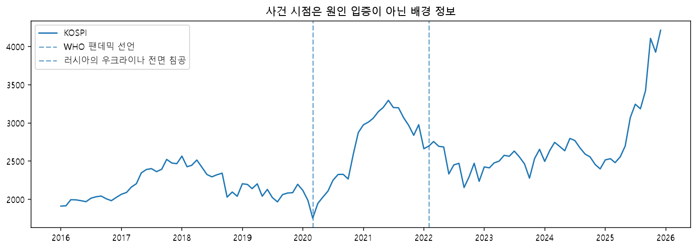
WHO 2020-03-11 팬데믹 선언과 UN 2022-02-24 성명을 근거로 표시했다. 전후 각각 12개월, 사건 달 제외 비교 결과는 대시보드 자료에 포함된다.

## 질문별로 읽는 그래프와 답변

### 1. 여러 지표의 흐름을 겹치면 무엇이 보일까?

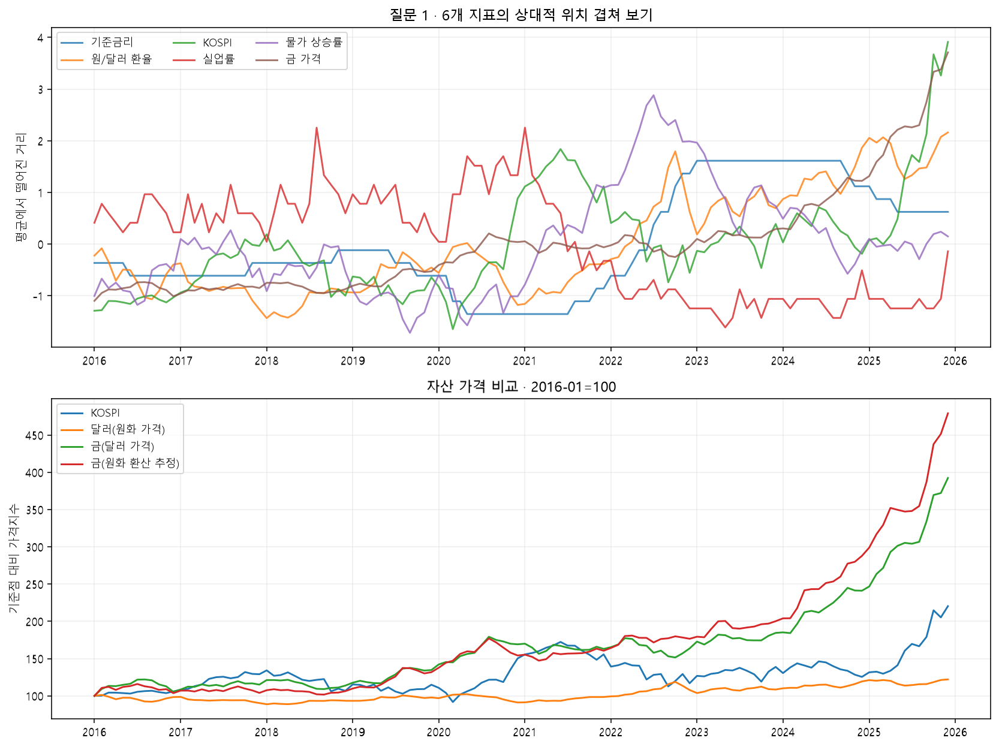

위 그래프는 단위가 다른 6개 지표를 비교하기 위해 표준화(각 지표의 평균을 0으로 맞추고, 평소 흔들리는 정도를 1로 맞추는 방법)했다. 세로축의 +1은 그 지표가 자기 평균보다 평소 흔들림 한 번만큼 높다는 뜻이다. 선이 겹친다고 가격이나 변화율이 같다는 뜻은 아니다. 물가는 가격 수준이 아니라 물가 상승률이다. 전체 기간의 자료로 계산했으므로 그 당시 바로 사용할 수 있었던 투자 신호로 해석하지 않는다.

아래 그래프는 자산 가격의 시작점을 100으로 맞췄다. 금의 원화 환산 추정치는 달러 금 가격 × 원/달러 환율이다. 두 월평균의 곱은 일별 원화 환산 금 가격의 월평균과 다르며, 국내 금 시세·ETF 수익률을 뜻하지 않는다. 배당·이자·세금·수수료는 포함하지 않는다.

### 2. 함께 또는 반대로 움직인 조합은 무엇일까?

월간 변화의 상관행렬(여러 지표가 함께 움직인 정도를 한 표에 모은 것, 앞의 그림 04)로 확인한다. 가격이 장기간 함께 오른 것과 매월 같은 방향으로 움직인 것은 서로 다르다. 아래는 KOSPI와 각 자산의 상관계수(두 값이 함께 움직인 정도를 -1부터 +1 사이로 나타낸 숫자)다. 표본(분석에 사용한 자료)은 각각 120개월이다.

| 비교 대상 | KOSPI와의 상관 |
|---|---:|
| 달러(원화 가격) | -0.324 |
| 금(달러 가격) | 0.236 |
| 금(원화 환산 추정) | 0.057 |

양수는 같은 방향, 음수는 반대 방향으로 움직인 경우가 많았다는 뜻이다. 0에 가까우면 선형 관계(한쪽이 움직일 때 다른 쪽도 일정한 방향으로 움직이는 관계)가 약했다는 뜻이다. 이 숫자 하나만으로 안전한 자산인지 판단하거나 미래에도 같은 관계가 이어진다고 단정할 수는 없다.

### 3. 주식이 떨어질 때 금이나 달러가 도움이 됐을까?

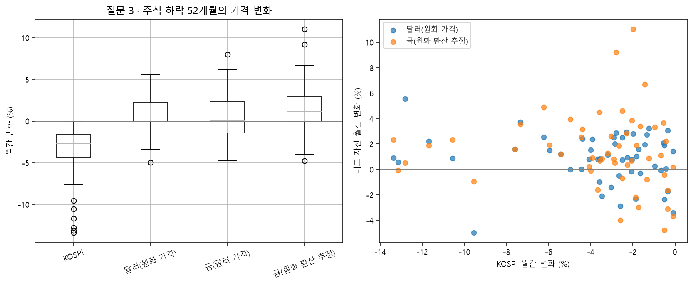

상자 가운데 선은 중앙값(자료를 크기순으로 놓았을 때 한가운데 값)이다. 상자는 전체 자료 중 가운데 50%가 모인 범위다. 상자에서 멀리 떨어진 점도 실제 자료이므로 삭제하지 않았다. 오른쪽 그래프에서 0 위의 점은 주식이 하락한 달에 비교 자산 가격이 상승한 경우다.

| 자산 | 주식 하락 달 수 | 그중 상승 / 하락 달 수 | 해당 달 평균 변화 |
|---|---:|---:|---:|
| KOSPI | 52 | 0 / 52 | -3.75% |
| 달러(원화 가격) | 52 | 38 / 14 | 0.86% |
| 금(달러 가격) | 52 | 26 / 24 | 0.55% |
| 금(원화 환산 추정) | 52 | 38 / 14 | 1.40% |

상승·하락 달 수의 합이 전체보다 작으면 나머지는 가격 변화가 정확히 0인 달이다. 비교 자산이 상승한 달에는 주식 손실의 일부를 줄이는 데 도움이 되었을 가능성이 있다. 그러나 함께 하락한 달도 있으므로 항상 주식 손실을 막아준 것은 아니다. 위 표는 자산별 가격만 비교했으며 실제 혼합 포트폴리오(여러 자산을 함께 담은 투자 묶음)의 손익은 계산하지 않았다. 보유 비중, 사고판 시점, 재조정(정해 둔 비중으로 다시 맞추는 일) 방법에 따라 결과가 달라진다.

### 4. 금이나 달러 자체는 얼마나 흔들리고 떨어졌을까?

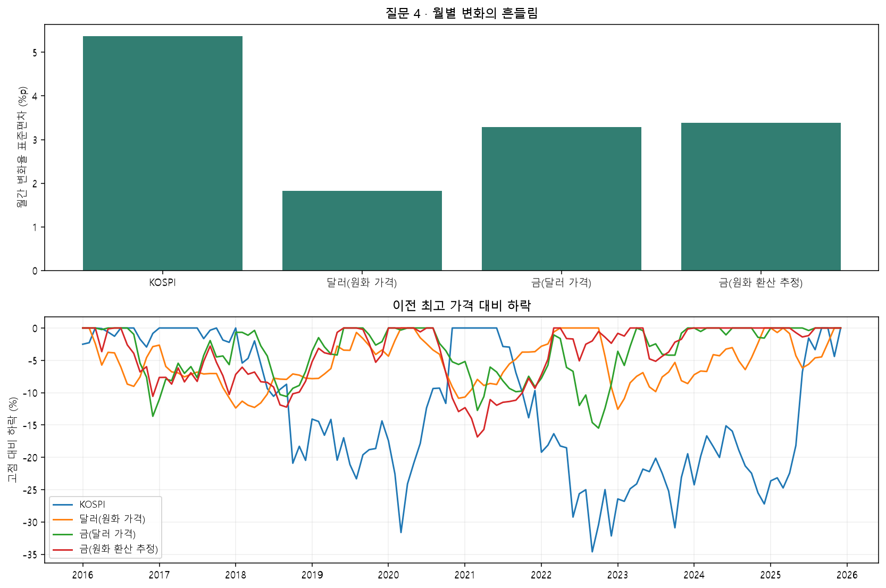

표준편차(값들이 평균에서 얼마나 넓게 흩어져 있는지 나타내는 숫자)가 클수록 월별 가격 변화가 더 크게 흔들렸다. 최대 고점 대비 하락은 지금까지 관측한 가장 높은 가격에서 이후 가장 낮은 가격까지 얼마나 떨어졌는지를 나타낸다. 예를 들어 100에서 80으로 떨어졌다면 -20%다. 계산을 시작하기 위한 기준값으로 2015-12를 포함하고 2016~2025년을 평가했다.

| 자산 | 월간 변화 표준편차 | 최악의 월간 변화 (월) | 최대 고점 대비 하락 (저점 월) |
|---|---:|---:|---:|
| KOSPI | 5.37%p | -13.37% (2018-10) | -34.62% (2022-09) |
| 달러(원화 가격) | 1.82%p | -4.98% (2022-12) | -12.58% (2023-01) |
| 금(달러 가격) | 3.28%p | -6.54% (2016-12) | -15.49% (2022-10) |
| 금(원화 환산 추정) | 3.38%p | -4.88% (2016-12) | -16.85% (2021-03) |

이 자료는 한 달에 한 번만 값을 비교하므로, 월중에 잠깐 발생했다가 회복된 급락은 보여주지 못한다. 금과 환율은 한 달 평균값이고 KOSPI는 월말 값이어서 완전히 같은 조건의 비교도 아니다. 따라서 이 숫자만으로 어느 자산이 더 안전하다고 결론 내릴 수 없다. KOSPI와 상관계수가 낮은 자산도 그 자산 자체의 가격은 크게 떨어질 수 있다.

### 5. 위기 전후에도 관계가 유지됐을까?

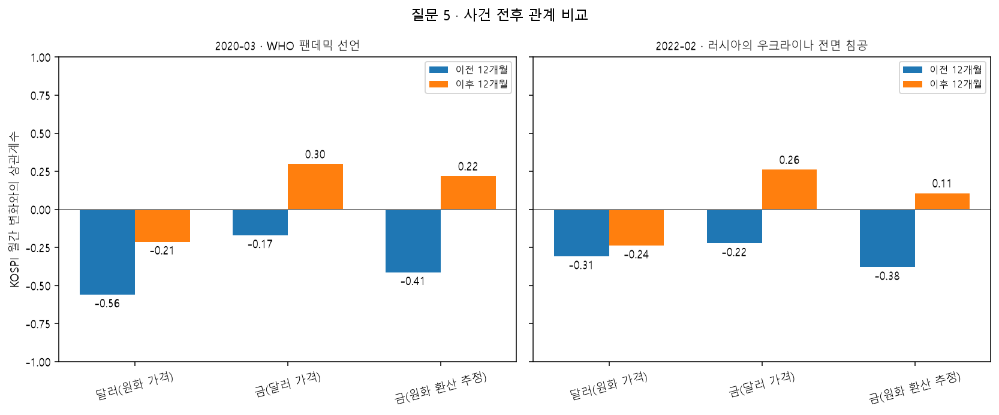

각 사건이 발생한 달은 빼고, 그 앞 12개월과 뒤 12개월의 월간 변화를 비교했다. 위기 전체 기간을 분석한 것이 아니라 사건 주변의 짧은 기간만 살펴본 것이다. 사건이 일어난 달의 큰 변화는 상관계수 계산에서 빠져 있다. 같은 시기에 다른 사건과 정책도 있었기 때문에 어느 한 가지가 원인이라고 가려낼 수 없다.

- WHO 팬데믹 선언: 달러(원화 가격)와 KOSPI의 상관 -0.56 → -0.21; 금(달러 가격)와 KOSPI의 상관 -0.17 → 0.30; 금(원화 환산 추정)와 KOSPI의 상관 -0.41 → 0.22.
- 러시아의 우크라이나 전면 침공: 달러(원화 가격)와 KOSPI의 상관 -0.31 → -0.24; 금(달러 가격)와 KOSPI의 상관 -0.22 → 0.26; 금(원화 환산 추정)와 KOSPI의 상관 -0.38 → 0.11.

사건 전과 후에 사용한 자료가 각각 12개월뿐이어서 같은 결과가 반복될 것이라고 단정하기 어렵다. 전체 기간에 상관계수가 낮았더라도 특정 위기에서 반드시 손실을 줄여준다는 뜻은 아니다.

## 분석을 통해 알게 된 점

분석한 120개월 동안 달러 가격은 KOSPI와 반대 방향으로 움직인 경우가 비교적 많았다. 원화로 바꿔 계산한 금 가격은 KOSPI와 뚜렷하게 같은 방향이나 반대 방향으로 움직이지 않았다. KOSPI가 하락한 52개월 가운데 달러와 원화 환산 금은 각각 38개월 상승했다. 반대로 KOSPI와 함께 하락한 달도 각각 14개월이었다. 따라서 금과 달러가 일부 주식 하락기에 도움이 된 적은 있지만 언제나 같은 역할을 한 것은 아니다.

관계는 시기에 따라서도 달라졌다. 사건 전후 12개월을 비교했을 때 금과 KOSPI의 상관계수가 음수에서 양수로 바뀐 사례가 있었다. 달러와 KOSPI가 반대로 움직이는 정도도 강해지거나 약해졌다. 과거에 발견한 관계가 앞으로도 그대로 이어진다고 볼 수는 없다.

이 결과만으로 어떤 자산배분 전략(돈을 여러 자산에 나누는 방법)이 더 좋다고 판단할 수는 없다. 다만 한 자산이나 한 지표만으로 시장 전체를 설명하기 어렵다는 점은 확인할 수 있었다. 성격이 다른 자산과 경제 상황을 함께 살펴볼 이유도 여기에 있다. 여러 자산을 실제로 함께 보유했을 때의 결과를 알려면 보유 비중, 상품, 사고판 시점, 재조정 방법, 수수료를 정해 따로 계산해야 한다.

## 근거가 있는 인사이트
1. **관찰:** 환율과 KOSPI 월간 변화의 상관계수는 -0.324(n=120, 자료 120개)다. **해석:** 두 값이 주로 반대 방향으로 움직였다는 단서는 된다. 그러나 국제 자금 이동 등 그 이유까지 이 분석만으로 증명할 수는 없다. **활용:** 원화 가치가 약해졌다는 사실 하나만으로 개별 기업의 주가 방향을 판단하지 않는다.
2. **관찰:** 금리 인상 달은 12개월이며 그중 KOSPI 상승 달은 6개월, 평균 변화율은 1.03%다. 금리 인하 달은 9개월, KOSPI 평균 변화율은 -1.26%다. **해석:** 금리 방향 하나가 주가 방향을 결정하지 않았다. 경기 상황과 정책에 대한 시장의 반응이 함께 작용할 수 있다. **활용:** 평균만 보지 말고 값들이 얼마나 넓게 퍼져 있는지와 사용한 달의 수도 확인한다.
3. **관찰:** 금과 KOSPI 월간 변화의 상관계수는 0.236다. 금 가격 계산 기준이 바뀌기 전만 보면 0.133(n=113)다. **해석:** 분석 기간과 자료를 계산한 방법에 따라 결과가 달라질 수 있다. **활용:** 금이 언제나 주식과 반대로 움직인다고 생각하지 않는다.

## 보너스: 분해와 예측
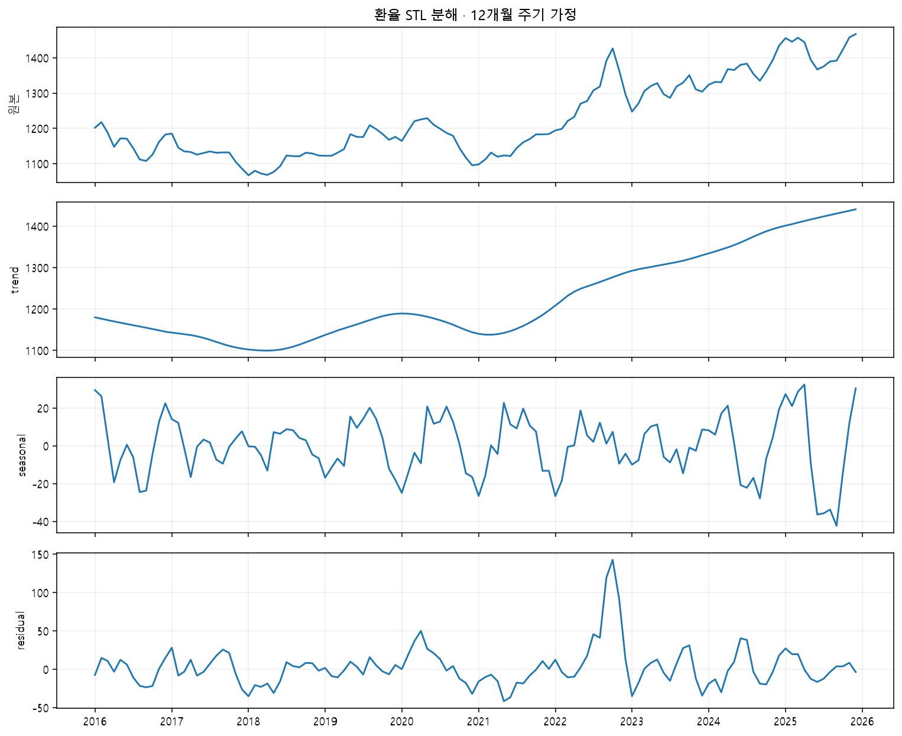
STL 분해(하나의 움직임을 장기 흐름, 계절마다 반복되는 움직임, 나머지 움직임으로 나누는 방법)이며 12개월 주기를 가정했다. 이 그림은 10년 전체 자료를 사용해 과거를 나눈 결과다. 당시에는 미래 자료를 알 수 없었으므로 실시간 매매 신호로 사용할 수 없다. 이 결과를 아래 예측 모델의 입력으로 사용하지 않았다.

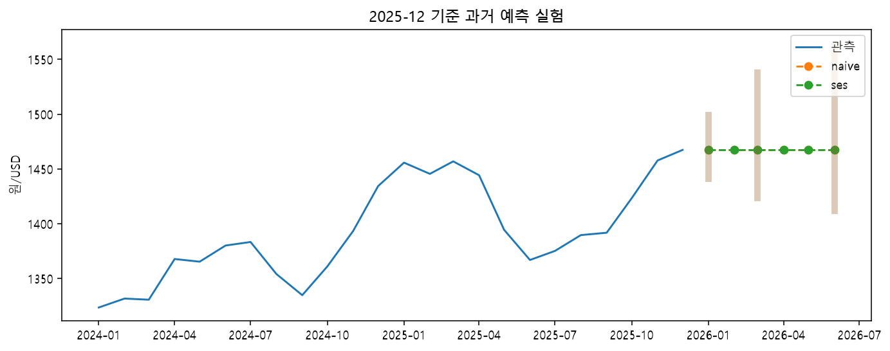
처음 60개월 자료로 시작하고, 시간이 지날 때마다 새로 알게 된 자료를 추가해 예측했다. 매번 1·3·6개월 뒤를 예측했으며 그 시점에 아직 알 수 없었던 미래 값은 사용하지 않았다. 마지막 값이 그대로 이어진다고 보는 방법(naive)과 최근 값에 더 큰 무게를 주는 단순 지수평활(SES)을 같은 조건에서 비교했다. MAE(예측값이 실제값과 평균적으로 얼마나 차이 났는지)는 원/USD 단위다.

| 모델 | 몇 개월 뒤 예측 | 비교한 횟수 | 평균 절대 오차(MAE) |
|---|---:|---:|---:|
| naive | 1 | 60 | 20.67 |
| naive | 3 | 58 | 45.47 |
| naive | 6 | 55 | 56.89 |
| ses | 1 | 60 | 20.67 |
| ses | 3 | 58 | 45.47 |
| ses | 6 | 55 | 56.89 |

2026-01~06 예측은 2025-12까지만 알고 있었다고 가정한 과거 실험이며 현재의 환율 전망이 아니다. 막대는 과거 예측 오차 중 가운데 80%가 들어간 범위(10백분위~90백분위)를 보여준다. 미래 환율이 이 안에 들어갈 확률이 정확히 80%라는 뜻은 아니다. 이후 수정된 공식 자료를 사용했기 때문에 당시 공개된 자료만으로 한 실험과 완전히 같지는 않다.

## 입문자 체크리스트와 한계
지표의 단위와 기간, 월말 값인지 월평균인지, 원화인지 달러인지, 자료가 몇 개인지를 확인한다. 두 값이 함께 움직였다는 사실과 왜 그렇게 움직였는지에 대한 추측은 구분한다. 전체 10년 결과와 짧은 기간의 결과를 함께 본다. 지표 하나만 보고 매수나 매도를 결정하지 않는다.

상관관계는 인과관계가 아니다. 두 값이 함께 움직였다고 해서 한쪽이 다른 쪽의 원인이라고 바로 말할 수는 없다.

시계열 자료(시간 순서대로 이어진 자료)에는 자기상관(이번 달 값이 지난달 값과 이어지는 성질)이 있을 수 있다. 전년 동월 대비 물가도 매달 계산에 사용하는 12개월 중 많은 부분이 서로 겹친다. 여러 시차를 비교하면 우연히 커 보이는 숫자가 나올 수도 있다. 금리 인상기나 사건 전후처럼 짧게 나눈 구간은 자료 수가 적다. 이런 이유로 이번 결과가 우연이 아니라고 확신하거나, 다른 시기에도 똑같이 나타날 것이라고 일반화(일부 결과를 더 넓은 상황에도 적용하는 것)해서는 안 된다.

미국 금리, 기업 실적, 산업생산, 국제유가, 투자자의 기대처럼 이번 분석에 넣지 않은 요인도 많다. 현재 여섯 지표는 통화정책·환율·주식·금·물가·고용의 기본 흐름을 익히기 위한 범위이며 경제 전체를 설명하지 않는다. 사건 전후에도 여러 충격이 동시에 일어났을 수 있다. 이 보고서는 교육용 자료이며 개인에게 맞춘 투자 조언이나 수익 보장이 아니다.

## AI 사용 로그
| 사용 작업 | 이유 | 검증 방법 |
|---|---|---|
| 수집·정제(자료를 분석하기 좋게 다듬는 일) 코드 | 반복 작업 자동화 | 공식 항목명·기간 확인, 누락·중복·변화 계산 테스트 |
| 통계·분해·예측 코드 | 계산 방법 구현과 비교 | 간단한 예시로 계산 확인, 미래 값을 미리 사용하지 않았는지 검사 |
| 보고서 초안·화면 | 쉬운 설명과 결과 공유 | 저장된 계산값으로 문장 생성, 그래프·실행 검증 |

## 제출 상태
분석 파일은 `analysis.py`로 다시 만들 수 있다. 실행 방법, 데이터 출처와 공개 대시보드 주소는 README에 정리했다.
