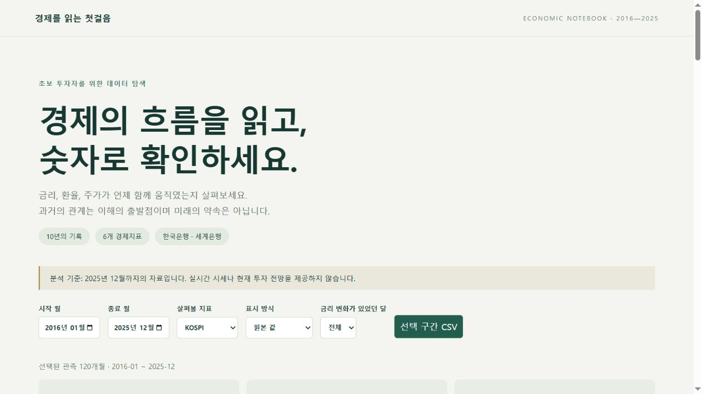
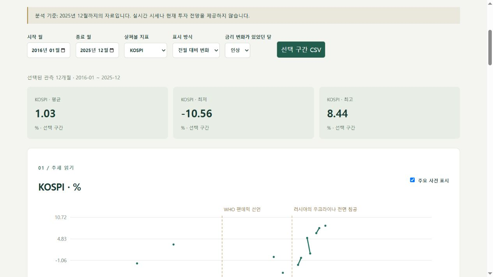
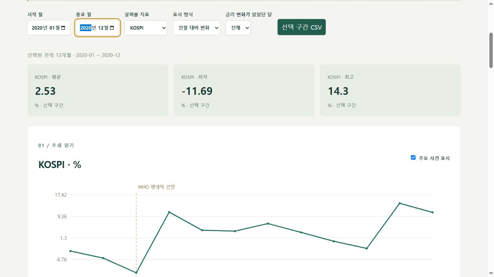

# 대시보드 시연 및 보너스 제출 안내

미션의 서비스화 보너스는 배포 URL, 시연 영상, 또는 스크린샷 세트와 시나리오 중 하나로 제출할 수 있다. 이 문서는 로컬 스크린샷 방식의 증빙이며 Vercel 배포는 별도로 진행한다.

## 실행 방법

README의 가상환경 설치 후 프로젝트 루트에서 실행한다.

```powershell
.venv/Scripts/python.exe -m http.server 8765 --bind 127.0.0.1 --directory web
```

브라우저에서 http://127.0.0.1:8765 를 연다. 고정된 정제 결과를 사용하므로 웹 실행에는 인증키가 필요하지 않다.

## 시나리오 1: 전체 기간 탐색

시작 월 2016-01, 종료 월 2025-12, KOSPI, 원본 값, 금리 조건 전체를 선택한다. 관측 120개월이 표시된다. KOSPI 원본 단위는 포인트이며 아래 상관행렬은 원본 수준이 아닌 월간 변화의 관계다.



## 시나리오 2: 금리 인상 달만 비교

표시 방식을 전월 대비 변화로, 금리 조건을 인상으로 바꾼다. 12개월로 줄고 KOSPI 평균 변화율은 반올림해 1.03%다. 조건에서 빠진 달을 선으로 이어 붙이지 않는다. 금리 인상이 언제나 주가 하락을 뜻하는 것은 아니며 작은 표본의 평균을 미래 예측으로 사용하지 않는다.



선택 구간 CSV를 누르면 12개월 × 6개 지표 = 72행의 원본 값이 다운로드된다. 2026-09-18 실제 저장 파일의 모든 값과 날짜를 웹 원자료와 대조해 일치를 확인했다. 화면의 변화율 모드와 무관하게 다운로드는 원본 값이다.

## 시나리오 3: 분석 기간 변경

금리 조건을 전체로 되돌리고 2020-01~2020-12를 선택한다. 12개월의 통계와 상관행렬을 확인한다. 이 선택은 상단 추세와 상관행렬에만 적용되며 시차·사건·STL·예측은 화면에 명시한 전체 기간 고정 분석이다.



## 심화 보너스 증빙

- 분해: REPORT.md의 STL 그림과 해석, src/forecast.py. 12개월 주기를 가정했으며 반복 패턴을 보장하지 않는다.
- 예측: REPORT.md의 마지막 값 유지/지수평활 비교와 MAE, 학습 종료일 및 한계. 미래 관측을 학습에 사용하지 않는 확장 창 검증이다.

## 제출 전 사용자 확인

세 시나리오를 직접 실행하고, 평균과 변화율, 상관과 인과의 차이를 자신의 말로 설명한다. GitHub 업로드 및 Vercel 공개 주소는 실제 완료 후 README와 docs/acceptance.md에 기록한다.
